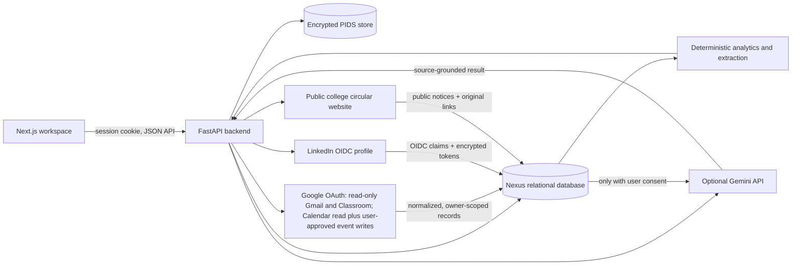

# Nexus AI architecture

## System map

## Components and responsibilities

- **Next.js frontend:** dashboard, task tracking, calendar, insights, source connections, LinkedIn professional hub and settings. It stores no provider secrets and calls the backend using the browser session.
- **FastAPI backend:** authentication callbacks, owner-scoped API operations, provider sync, validation, privacy controls and response shaping.
- **Nexus database:** normalized users, email, calendar, tasks, suggestions, notices, classroom items and LinkedIn OIDC profile. Provider tokens are encrypted before persistence.
- **PIDS store:** separate personal-data intelligence subsystem for approved memories, provenance and bounded analysis. Its database and vault are distinct from the legacy Nexus database.
- **Deterministic engine:** date parsing, task/calendar counts, deadline pressure, workload metrics and source-based fallback. It remains usable when no model is configured.
- **Gemini provider:** optional analysis of bounded relevant source text and user questions only after the user's AI-data consent is enabled. The fixed connectivity check contains no personal records.

## Data flows

1. A user signs in with Google; the backend validates the OAuth response and binds the session to a Nexus user.
2. User-triggered sync reads authorized Google data and public college circulars. Records are normalized, deduplicated and stored under that user. Classroom requires its own Google permission.
3. LinkedIn connect uses the server-side authorization-code flow with state and OIDC nonce. The backend verifies the ID token against LinkedIn's published keys, issuer, audience and expiry, checks userinfo subject, then encrypts the access token. Only returned OIDC profile claims are shown; no profile scraping is performed. Connections and member-post data remain gated behind LinkedIn partner permissions.
4. Analytics read that user's stored source records. Rules produce counts and deadline signals; model-assisted analysis is optional and consent-gated. Insights retain source references so users can inspect the underlying record.
5. Disconnect removes that user's local provider connection and stored tokens. Google and LinkedIn grants are governed by the provider's own account controls.

## Trust boundaries

- OAuth client secrets and Gemini keys stay in backend environment configuration.
- Every personal record query is scoped to the authenticated user; provider tokens never go to the frontend.
- Gmail, Classroom and LinkedIn profile connections are read-only. Calendar events can be created or updated only after the user grants event-edit scope and explicitly saves an event. Nexus does not send email, submit classwork or change grades.
- The general-purpose Ask Nexus chatbot and email reply-draft feature are retired.
- Database migrations are explicit. The isolated PIDS storage does not share the legacy Nexus migration chain.
